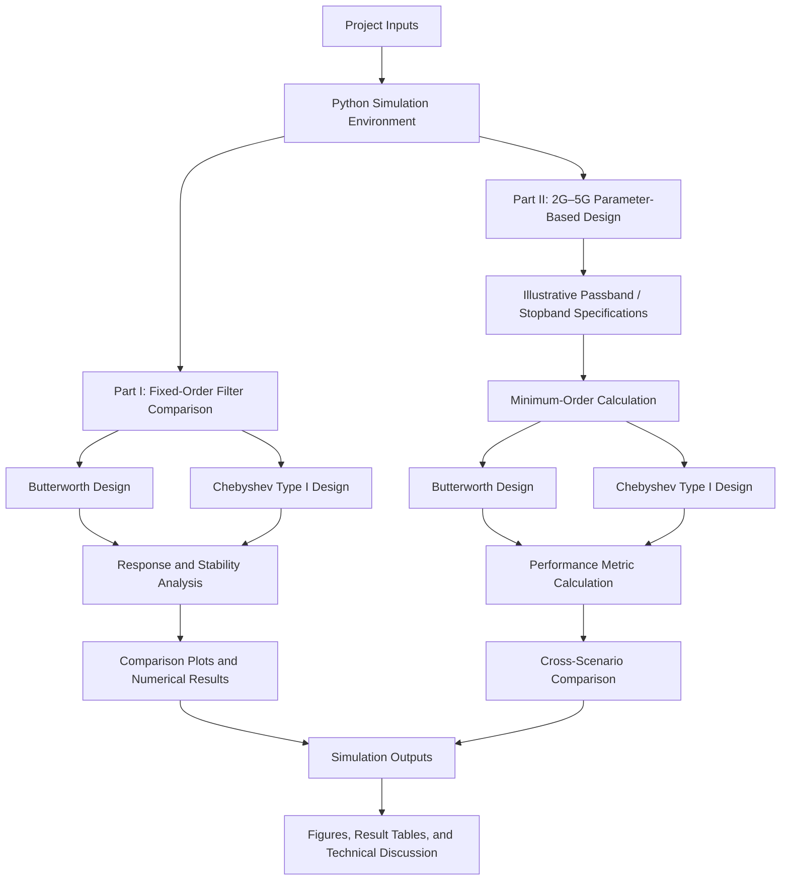
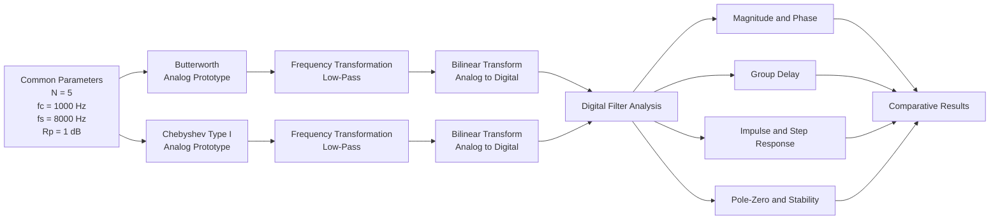
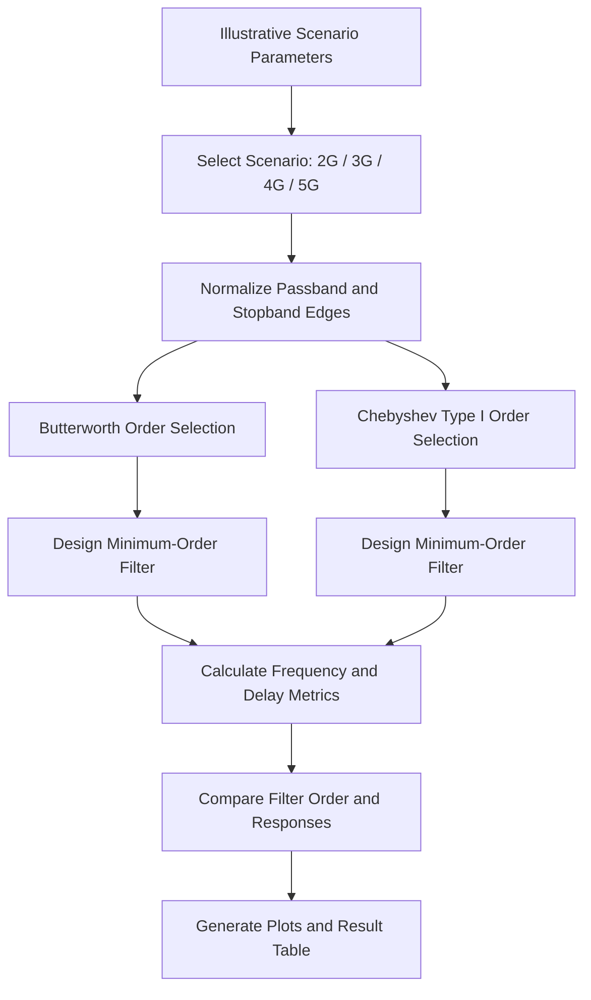

<div align="center">

# DGT-18
## A Comprehensive Comparison of Butterworth and Chebyshev Type I Filters

**Digital Signal Processing | IIR Filter Design | Frequency-Domain Analysis | 2G–5G Parameter-Based Illustration**

</div>

---

## Abstract

This project presents a computational study of two classical Infinite Impulse Response (IIR) low-pass filter families: **Butterworth** and **Chebyshev Type I**. The objective is to evaluate their frequency-response characteristics and design trade-offs through Python-based simulation.

The study is organized into two parts. First, both filters are designed with the same order and nominal cutoff frequency, then examined using magnitude response, phase response, group delay, impulse response, step response, pole-zero distribution, and stability analysis. Second, minimum-order analog low-pass filters are designed against four sets of illustrative passband and stopband specifications labelled 2G (GSM), 3G (WCDMA), 4G (LTE), and 5G (NR). The resulting filter orders and response metrics are compared.

The simulations demonstrate the fundamental distinction between the two filter families: Butterworth filters provide a maximally flat passband, whereas Chebyshev Type I filters permit controlled passband ripple in exchange for a sharper transition and, under the selected specifications, a lower required filter order. The results also highlight the associated trade-off in group-delay behavior.

**Important scope note:** The 2G–5G cases are parameter-based educational examples. Their frequency and attenuation values are assumed inputs for comparing filter-design behavior; they are not presented as official 3GPP specifications or as descriptions of the actual filter architectures used in commercial cellular networks.

## 1. Project Overview

Digital filters are essential components in signal-processing systems. They are used to suppress unwanted frequency components, shape signal spectra, and isolate frequency bands of interest. Selecting an appropriate filter requires balancing several characteristics, including passband flatness, stopband attenuation, transition-band sharpness, phase response, group delay, and implementation complexity.

This project focuses on the comparison of:

- **Butterworth low-pass filter:** characterized by a maximally flat magnitude response in the passband.
- **Chebyshev Type I low-pass filter:** characterized by equiripple behavior in the passband and a steeper transition for a comparable design constraint.

The project uses Python and scientific-computing libraries to design the filters, calculate performance metrics, generate plots, and report numerical results.

### Project Objectives

1. Design Butterworth and Chebyshev Type I IIR low-pass filters.
2. Compare their magnitude and phase responses.
3. Examine group delay and time-domain responses.
4. Analyze pole-zero locations and verify digital-filter stability.
5. Determine the minimum filter order required to satisfy each illustrative specification set.
6. Compare the resulting filter orders and response characteristics across the four 2G–5G-labelled scenarios.
7. Discuss the engineering trade-offs between passband flatness, transition sharpness, delay behavior, and filter complexity.

## 2. System Architecture

The project consists of two independent simulation paths. The first performs a controlled comparison using a fixed filter order and sampling configuration. The second performs specification-driven, minimum-order filter design for four illustrative scenarios.

### 2.1 Overall Architecture



### 2.2 Part I — Fixed-Order Filter Analysis



### 2.3 Part II — Specification-Driven Design



## 3. Simulation Workflow

The simulation follows the workflow below:

1. **Parameter definition:** Set the sampling frequency, cutoff frequency, filter order, passband ripple, and scenario-specific passband/stopband requirements.
2. **Filter prototype design:** Generate Butterworth and Chebyshev Type I analog low-pass prototypes.
3. **Frequency transformation:** Transform the normalized prototypes to the required low-pass frequency.
4. **Digital conversion (Part I):** Apply the bilinear transformation to obtain digital IIR filters.
5. **Minimum-order calculation (Part II):** Use the passband and stopband constraints to determine the minimum order for each filter family.
6. **Response evaluation:** Calculate magnitude response, phase response, group delay, and other relevant characteristics.
7. **Stability assessment (Part I):** Inspect digital pole locations and verify that the maximum pole magnitude is below one.
8. **Visualization and reporting:** Generate comparative plots and print numerical results.

## 4. Theoretical Background

### 4.1 Butterworth Filter

A Butterworth filter is designed to have a maximally flat magnitude response in the passband. It does not exhibit passband ripple, and its magnitude response decreases monotonically as frequency moves into the stopband.

**Main characteristics:**

- Maximally flat passband.
- Monotonic passband and stopband responses.
- Smooth magnitude response.
- Typically requires a higher order than a Chebyshev Type I filter when both are designed to meet the same demanding transition specifications.

### 4.2 Chebyshev Type I Filter

A Chebyshev Type I filter allows controlled equiripple variation in the passband. This relaxation enables a steeper transition between the passband and stopband for a given filter order, or a lower order for a selected set of passband and stopband requirements.

**Main characteristics:**

- Equiripple passband.
- Monotonic stopband.
- Sharper transition than a Butterworth filter of comparable order under typical comparable constraints.
- Greater phase and group-delay variation may occur, depending on the design.

### 4.3 Key Performance Metrics

| Metric | Description | Engineering significance |
|---|---|---|
| Magnitude response | Filter gain versus frequency | Shows passband behavior and stopband attenuation |
| Passband ripple / variation | Gain variation within the passband | Indicates amplitude distortion |
| Stopband attenuation | Suppression of unwanted frequency components | Indicates out-of-band rejection |
| Phase response | Phase shift versus frequency | Describes phase distortion |
| Group delay | Negative derivative of phase with respect to angular frequency | Indicates frequency-dependent signal delay |
| Filter order | Number of poles / system order | Relates to complexity and implementation cost |
| Pole locations | Roots of the denominator polynomial | Used to assess IIR stability |

For a causal digital IIR filter, all poles must lie strictly inside the unit circle for BIBO stability.

## 5. Project Implementation

### 5.1 Part I — Fixed-Order Comparison

The first Python program designs both filter types using the following common parameters:

| Parameter | Value |
|---|---:|
| Filter type | Low-pass IIR |
| Filter order | 5 |
| Sampling frequency (\(f_s\)) | 8,000 Hz |
| Nominal cutoff frequency (\(f_c\)) | 1,000 Hz |
| Chebyshev Type I passband ripple | 1 dB |

The analog prototypes are transformed into digital filters using the bilinear transformation. The program then evaluates:

- Digital magnitude response in decibels and linear scale.
- Analog-versus-digital frequency response.
- Phase response.
- Group delay.
- Unit impulse response.
- Unit step response.
- Pole-zero locations and stability.

**Interpretation note:** In the current implementation, the reported quantity named “passband ripple” is calculated as the maximum-to-minimum magnitude variation over 0 to \(f_c\). Since \(f_c\) is the Butterworth cutoff frequency, this interval includes the cutoff roll-off; therefore, the reported Butterworth value is not a strict passband-ripple specification. It is more accurately interpreted as magnitude variation over the selected 0–\(f_c\) interval.

### 5.2 Part II — 2G–5G Parameter-Based Illustration

The second Python program uses four assumed low-pass design cases. For each case, the program calculates the minimum order required for Butterworth and Chebyshev Type I filters to satisfy the selected passband and stopband constraints.

| Illustrative label | Passband edge (\(f_p\)) | Stopband edge (\(f_{st}\)) | Passband limit (\(R_p\)) | Stopband attenuation (\(A_s\)) |
|---|---:|---:|---:|---:|
| 2G (GSM) | 100 kHz | 300 kHz | 3 dB | 40 dB |
| 3G (WCDMA) | 1.92 MHz | 3.6 MHz | 1 dB | 45 dB |
| 4G (LTE) | 9 MHz | 11.5 MHz | 0.5 dB | 50 dB |
| 5G (NR) | 49.5 MHz | 58 MHz | 0.25 dB | 55 dB |

These values are **simulation assumptions** used to create progressively different filter-design constraints. They must not be interpreted as official cellular-standard channel bandwidths, RF filter masks, or mandatory 3GPP requirements.

## 6. Results and Comparative Analysis

### 6.1 Fixed-Order Filter Results

The recorded simulation output reports the following values for the fifth-order filters:

| Metric | Butterworth | Chebyshev Type I |
|---|---:|---:|
| Maximum pole magnitude | 0.8008 | 0.9385 |
| Magnitude variation over 0–\(f_c\) | 2.993 dB | 1.000 dB |
| Attenuation at 2,000 Hz | −38.3 dB | −54.5 dB |
| Average group delay in 0–\(f_c\) | 5.00 samples | 6.85 samples |
| Group-delay variation in 0–\(f_c\) | 3.26 samples | 13.44 samples |
| Stability | Stable | Stable |

Both digital filters are stable because their maximum pole magnitudes are below one. Under the selected configuration, the Chebyshev Type I filter provides stronger attenuation at 2,000 Hz, while exhibiting greater group-delay variation. The Butterworth filter provides a smoother response characteristic and lower group-delay variation in this comparison.

### 6.2 Minimum Filter Order Across Illustrative Scenarios

| Scenario | Butterworth order | Chebyshev Type I order |
|---|---:|---:|
| 2G (GSM) | 5 | 4 |
| 3G (WCDMA) | 10 | 6 |
| 4G (LTE) | 28 | 11 |
| 5G (NR) | 49 | 15 |

For the assumed specifications, Chebyshev Type I achieves the required attenuation with a lower filter order in all four scenarios. This illustrates the benefit of allowing passband ripple when transition sharpness and order reduction are important design objectives.

### 6.3 Engineering Discussion

The results illustrate that there is no universally superior filter family. The appropriate choice depends on the system's priorities:

- Choose **Butterworth** when passband smoothness and a maximally flat magnitude response are important.
- Choose **Chebyshev Type I** when a sharper transition or lower filter order is more important and controlled passband ripple is acceptable.
- Evaluate **group delay** when waveform shape or timing characteristics matter; magnitude response alone is not sufficient to assess signal fidelity.
- Evaluate **stability and numerical implementation** before deploying a high-order IIR filter. High-order designs may require second-order-section implementations and careful coefficient handling.

## 7. Repository Structure

```text
DGT-18/
├── README.md
├── anh_mo_phong.pdf
├── result.txt
├── so_sanh_butterworth_chebyshev.py
├── ung_dung_2G_5G.py
└── orgin_image/
    ├── so_sanh_butterworth_chebyshev.png
    └── ung_dung_2G_5G.png
```

> The directory name `orgin_image` is retained to match the supplied project files.

## 8. Technologies and Requirements

| Technology | Purpose |
|---|---|
| Python 3 | Simulation and scripting |
| NumPy | Numerical arrays and calculations |
| SciPy | IIR filter design and signal analysis |
| Matplotlib | Plot generation and visualization |

### Installation

Install Python 3, then install the required packages:

```bash
python -m pip install numpy scipy matplotlib
```

### Run the Simulations

Run the fixed-order comparison:

```bash
python so_sanh_butterworth_chebyshev.py
```

Run the 2G–5G parameter-based illustration:

```bash
python ung_dung_2G_5G.py
```

The scripts print numerical results and generate the corresponding plot files in the current working directory:

- `so_sanh_butterworth_chebyshev.png`
- `ung_dung_2G_5G.png`

The supplied project also includes the previously generated figures in the `orgin_image/` directory.

## 9. Limitations and Future Improvements

The project is a simulation-based comparison and does not implement a complete cellular communication link or a physical RF front end. In particular:

1. The 2G–5G-labelled specifications are illustrative assumptions, not official standards.
2. The second simulation uses normalized analog low-pass prototypes to compare minimum filter orders; it does not model a complete transmitter, receiver, modulation scheme, or propagation channel.
3. The first simulation uses one fixed order and one sampling configuration. Additional orders, cutoff frequencies, and ripple values could provide a broader comparison.
4. The current group-delay metric in the 2G–5G script is derived from a normalized frequency axis and should be interpreted as a normalized comparative metric, not as a directly measured hardware delay in seconds.
5. High-order IIR implementations should be validated using second-order sections and finite-precision analysis before practical deployment.

Potential extensions include adding Chebyshev Type II and elliptic filters, comparing FIR and IIR designs, evaluating quantization effects, and testing the filters with representative noisy signals.

## 10. Conclusion

This project compares Butterworth and Chebyshev Type I low-pass IIR filters through fixed-order analysis and specification-driven minimum-order design. The fixed-order results show the trade-off between magnitude-response behavior and group-delay variation. The parameter-based 2G–5G illustration further demonstrates that Chebyshev Type I can satisfy the selected constraints with a lower filter order, at the cost of allowing passband ripple and potentially greater delay variation.

Overall, filter selection should be based on the system's amplitude, phase, delay, complexity, and implementation requirements rather than on filter order or stopband attenuation alone.

## 11. References

1. SciPy Documentation — Signal Processing (`scipy.signal`): https://docs.scipy.org/doc/scipy/reference/signal.html
2. SciPy Documentation — `butter`: https://docs.scipy.org/doc/scipy/reference/generated/scipy.signal.butter.html
3. SciPy Documentation — `cheby1`: https://docs.scipy.org/doc/scipy/reference/generated/scipy.signal.cheby1.html
4. SciPy Documentation — `buttord`: https://docs.scipy.org/doc/scipy/reference/generated/scipy.signal.buttord.html
5. SciPy Documentation — `cheb1ord`: https://docs.scipy.org/doc/scipy/reference/generated/scipy.signal.cheb1ord.html
6. A. V. Oppenheim and R. W. Schafer, *Discrete-Time Signal Processing*, Pearson.

---

<div align="center">

**DGT-18 | Butterworth and Chebyshev Type I Filter Comparison**

</div>
